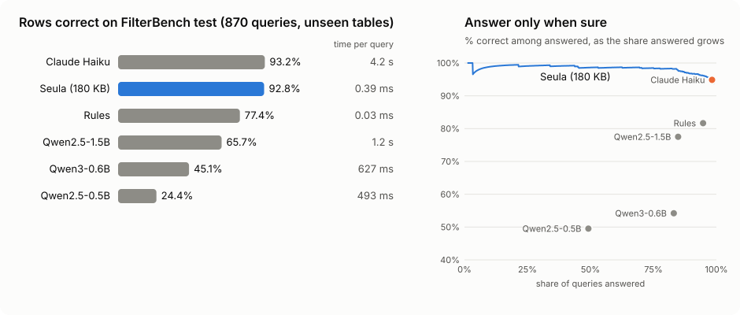

# Seula

**A filter box that reads plain English.**

Seula is a 182 KB model that turns what someone types above a table into structured filters. It runs in the browser or in Node with no API calls and works on tables it has never seen: you pass the rows, there is no retraining.

**[Try the live demo](https://seula.deeflect.com/demo)** on five sample tables or your own CSV. Site: [seula.deeflect.com](https://seula.deeflect.com).

```
overdue and balance at least 1k     →  Status = overdue  AND  Balance >= 1000
gdp per cap over 30k, not euro      →  GDP per cap. (PPP) > 30000  AND  Currency != euro
population over 10 million          →  Population > 10000000
directed by marcos siega            →  Directed by = marcos siega
overdue or paid, top 3 by balance   →  Status = overdue OR paid,  sorted by Balance,  first 3
```

Every parse has a status. Apply `ok` results; show the reason for incomplete or unsupported queries, and ask before applying an ambiguous guess. Confidence is a heuristic, not a calibrated probability.

## Quick start

```sh
npm install seula
```

Until the first release is on npm, build the tarball from this repo: `npm install && npm run pkg && npm pack ./pkg`, then install that file in your project.

```ts
import { load } from "seula";

const seula = await load();
const invoices = seula.table([
  { client: "Northwind", status: "overdue", balance: 12400 },
  { client: "Fieldwork", status: "paid", balance: 0 },
  { client: "Acme", status: "overdue", balance: 310 },
]);

const result = invoices.parse("overdue and balance over 1k");
// result.conditions: [
//   { column: "status", type: "text", op: "=", value: "overdue" },
//   { column: "balance", type: "number", op: ">", value: 1000 },
// ]
// result.status: "ok"
if (result.status === "ok") invoices.apply(result);
```

Build the table once per dataset and call `parse` on every keystroke. `status` is `ok`, `incomplete`, `unsupported`, or `ambiguous`; non-`ok` results include a short `message`. To apply a candidate ambiguous result after explicit confirmation, call `invoices.apply({ ...result, confirmAmbiguous: true })`. Incomplete and unsupported results cannot be applied. `conditions` stays editable for simple filters; grouped OR/NOT filters use `expression` and must keep their tree intact.

| You have | Use |
|---|---|
| Rows in memory | `seula.table(rows)` |
| A table paged on the server | `seula.schema({ column: sampleValues })`, then send the full `result` to your API |
| TanStack Table | `toTanStack(result)` from `seula/tanstack` |
| A SQL database | `toSql(result)` from `seula/sql`, values always as parameters |

The package guide, [pkg/README.md](pkg/README.md), covers each of these and how the weights load.

## What it reads

| Typed | Parsed as |
|---|---|
| `balance over 1k`, `at least 16k`, `under 5` | number comparisons |
| `days late between 10 and 40` | two comparisons on one column |
| `overdue or paid` | either value |
| `not euro`, `clients except fieldwork` | exclusion |
| `directed by marcos siega` | a value found in the table |
| `last 30 days`, `before march 2024` | date comparisons, for columns that hold dates |
| `top 3 by balance`, `newest first` | sort and limit |
| `overdue and (balance over 1k or days late over 30)` | grouped Boolean expression |
| `count overdue`, `total overdue balance` | count or sum of matching rows |

Define table-specific concepts explicitly: `seula.table(rows, { concepts: { "at risk": [{ column: "daysLate", type: "number", op: ">", value: 10 }] } })`. Queries such as `at risk except Acme` compose that definition with normal filters. Concepts are scoped to that table; Seula does not learn new meanings from them.

Values are matched against what is in the table, and the result holds the value as the table spells it (`éva`, `850 watts`, `–3` with an en dash). Typo repair works for near misses on longer words and does not catch everything.

## How it compares



Historical v4c FilterBench test: 870 queries on tables the model never saw in training, scored by the rows returned. These figures include execution-guided rewriting, which the current runtime disables by default. The current held-out test and new-feature accuracy have not been measured; a dated development regression check and local timing are in [docs/benchmarks.md](docs/benchmarks.md).

| | Seula | Hand-written rules | Small local LLM (Qwen 0.5 to 1.5B) | Cloud LLM (Claude Haiku) |
|---|---|---|---|---|
| Rows correct | 92.8% | 77.4% | 24% / 45% / 66% (0.5B / 0.6B / 1.5B) | 93.2% |
| Right when it says it is sure | 98.2% on the 83% of queries with confidence 0.8 or more | no confidence | no useful confidence | no confidence |
| Time per query | 0.39 ms, CPU, one thread | 0.03 ms | 0.5 to 1.2 s on a laptop GPU | 0.9 to 4 s as we ran it, through a CLI |
| Size | 182 KB | none | 1 to 3 GB | API |
| Runs offline and in the browser | yes, no dependencies | yes | heavy | no |
| Cost per query | 0 | 0 | 0 | paid |

Read these as historical v4c results. The test queries were written by a language model, not collected from real users. Haiku saw three example rows per table while Seula read the whole table, and Haiku's latency includes CLI startup. The small LLMs were prompted with three examples and not fine-tuned. In that run Seula was right on 45 queries where Haiku was wrong, and Haiku was right on 49 where Seula was wrong. The old measured parse time grew with the table to about 28 ms at 50,000 rows.

How the sets were built, every number and the full list of caveats: [docs/benchmarks.md](docs/benchmarks.md). Products and research that solve the same problem another way: [docs/landscape.md](docs/landscape.md).

## How it works

1. **Read the query and the table together.** Each word gets a hashed word and letter-trigram embedding, plus link features: does it match a column name (exactly, fuzzily, by prefix), is it inside a cell of that column, is it a number, is the column numeric.
2. **Tag the values.** A small BiGRU marks which words are condition values (`overdue`, `1k`).
3. **Decide each condition.** For each value, pick the operator (`= != contains > >= < <=`) from nearby words, and the column from the links plus the header words just before and after it.
4. **Clean up.** Columns are assigned jointly, numbers are normalized (`1k`, `2.5m`, `10 million`), and text values can snap to real cells. The runtime preserves empty results; it does not rewrite a column or operator just to find rows. Historical v4c benchmarks used execution-guided decoding.
5. **Score it.** Confidence is a heuristic product of model decisions; status also checks for missing, unsupported, and uncertain interpretations.
6. **Rules for the rest.** Dates, yes/no columns, sorting and top-N go through a small rule pass before the model (`src/seula/extras.ts`): `last 30 days`, `created after 2025`, `not shipped`, `top 5 by balance`, `newest first`.

The model has 184k parameters and uses no pretrained language model. The shipped weights are trained only on queries written by open-weight models (Qwen3, Mistral). Training code is in `bench/seula.py`. The TypeScript runtime in `src/seula/model.ts` has no dependencies. Its explicit historical execution-guided mode matches Python on 74 parity cases, with confidence within 3e-6.

## Limits

- English only.
- One table at a time, no joins.
- It filters, sorts, limits, counts, and sums. It does not average or group results.
- Boolean `NOT`, `AND`, and `OR` support parentheses, with that precedence. Complex filters return `expression`; editing a simple `conditions` list is supported, but flattening a grouped expression changes its meaning.
- Implied conditions (`home games` meaning `H/A = H`) usually fail, with low confidence.
- A query that matches nothing remains an empty result; show people the parsed filters and status.
- Ranges and implied conditions can still be misread. Check the returned interpretation before using it for consequential decisions.

## Train your own

An LLM writes realistic queries for conditions sampled from real tables, so the labels are known by construction. Generating the data costs about $1 on OpenRouter and training takes about 20 minutes on a laptop CPU. Commands and what each batch of data added: [docs/training.md](docs/training.md).

The dev and test query files are not in this repository yet. They were written with Claude and will be regenerated with open-weight models before the benchmark data is published. The generator and the scorer are here.

## Develop

```sh
npm install
npm run dev      # the site and the demo, locally
npm test         # runtime, parity with Python, rules, API and adapters
npm run pkg      # build the npm package into pkg/dist
npm run deploy   # build and deploy to Cloudflare (wrangler.jsonc)
```

| Path | What is there |
|---|---|
| `src/seula/` | the runtime, the object API, the TanStack and SQL adapters, the weights |
| `pkg/` | the npm package manifest and its guide |
| `bench/` | training, the FilterBench generator and scorer, baselines |
| `worker/` | the Cloudflare worker that stores yes/no verdicts from the demo |
| `docs/` | benchmarks, training, landscape, and notes on the earlier prototype ([docs/v1-README.md](docs/v1-README.md)) |

The demo asks whether a parse was right. Answering sends the query, the column names and the parsed filter. The rows never leave the tab.

## Licence

Apache-2.0, code and weights. Seula is Finnish for sieve. Made by [Dee](https://deeflect.com). If you want this in your product, get in touch at [dee.agency](https://dee.agency).
